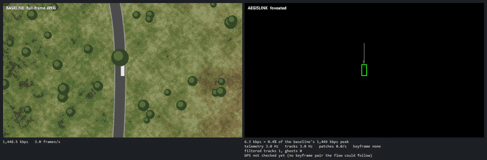
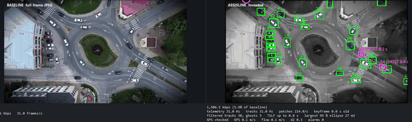

# AegisLink

A simulated UAV-to-ground video and telemetry link that keeps working under electronic warfare:
bursty packet loss, bandwidth down to tens of kbps, total blackouts and GPS spoofing. A C++20
proxy plays the jammed radio link between a UAV node and a ground station (Python, PyQt6), and
the results below come from scripted scenario runs through that proxy.



*Left: the plain full-frame JPEG stream. Right: the foveated stream rebuilt at the ground
station. The links are limited to 50 kbps (the baseline freezes, the tracks keep coming), then
blacked out for 5 s (the vehicles keep moving as ghost tracks, with their 95 % uncertainty
ellipses).*



*The same link over a real drone clip, with the vehicles found by YOLO on the GPU and the
camera's path measured from the clip. Halfway through, a 3 s blackout turns every car into a
ghost; when the link returns, the boxes snap back onto the cars.*

## What it does

- **The wire protocol** that all parts of the link use: a C++20 library with Python bindings for
  framing, CRC-checked parsing, fragmentation, and a reassembler that copes with lost, duplicated
  and reordered fragments.
- **`ew_chaos_proxy`**, a C++20 UDP proxy that plays the radio link. Each link it forwards has
  bursty packet loss (a Gilbert-Elliott model set by loss rate and mean burst length), a rate
  limit with a bounded queue, delay and jitter, timed blackouts, and a man-in-the-middle that
  moves the GPS position in the telemetry. All of it can be changed while traffic flows, through
  plain-text commands on a control port, and the proxy reports per-link counters 4 times per
  second. `link_meter` measures what comes out of a link.
- **A synthetic UAV world** with exact ground truth: a procedural 1 km x 1 km map with roads,
  trees and a bridge, traffic that follows, stops and disappears under trees, and a multirotor
  that follows one vehicle with a downward-looking camera. A simulated detector (misses, box
  noise, false alarms) feeds an IoU tracker that compensates for the camera's own motion.
- **Real video with YOLO**: the UAV can fly over a real drone clip instead. The camera's path
  (position, heading, altitude) is measured from the clip itself, frame by frame, so the
  telemetry fits what the camera sees, and YOLO26 trained on aerial images finds the vehicles,
  run through onnxruntime on the GPU.
- **Foveated streaming**: the UAV sends telemetry and track boxes every frame, small colour
  patches of the tracked vehicles, and now and then a small gray background, in that order of
  priority, within a byte budget that follows the ground station's receiver reports (grown
  while the link keeps up, cut when its queue starts to fill). A plain full-frame JPEG stream
  runs next to it for comparison.
- **A ground station dashboard** (PyQt6 and pyqtgraph) with both streams side by side. The
  foveated view is rebuilt from what arrived: the last gray background, moved and turned with
  the camera since it was taken, with each vehicle's newest colour patch blended onto its newest
  track box. Below: bitrates, message rates, plots of the last minute, and an EW deck whose
  sliders set loss, burst length, rate limit, delay, jitter, blackouts and GPS spoofing on the
  proxy while the link runs.
- **Ghost tracks**: the ground station follows every track with a Kalman filter (C++, constant
  velocity or constant acceleration) in ground metres, so camera motion does not leak into the
  vehicles' motion. When boxes stop arriving, a track turns into a ghost: its patch keeps moving
  along the prediction, drawn with its 95 % uncertainty ellipse, its predicted path and the
  time since its last fix.
- **GPS spoofing detection**: the ground station checks the GPS against what the camera saw.
  Optical flow between consecutive background keyframes, with their altitude and heading, gives
  the distance flown without the GPS. Three keyframes in a row that disagree (chi-square test at
  99 %) raise an alarm, and until five agree again the station navigates by the flow alone. The
  proxy's attacker recomputes the CRC, so its packets are accepted: a CRC catches noise, not an
  attacker (a real link would add a message authentication code, which is left out here on
  purpose).
- **Scripted scenarios**: JSON timelines of link settings (`scenarios/`) that run the proxy,
  the ground station and the UAV together and score what arrived against the ground truth.

## Results

Measured on one PC (Ryzen 7 7800X3D, RTX 4080) with the scripted scenarios in `scenarios/`:
the UAV, the proxy and a headless ground station run together and the station's numbers are
scored against the ground truth. Synthetic scenarios ran with seeds 1-3 (world, traffic and
proxy) unless noted.

| Scenario | What was measured | Result |
|---|---|---|
| `clean`, 30 s | foveated vs. baseline bitrate; track lists delivered | 124-183 kbps vs. 15,056-15,441 kbps (0.8-1.2 %); 100 % of frames' tracks at 30 Hz |
| `clean_10min`, seed 1 | the same over 10 minutes; GPS alarms | 208 vs. 14,642 kbps (1.4 %); 0 false alarms over 1,142 background keyframes |
| `kbps50`, 30 s | all links limited to 50 kbps | tracks of 100 % of frames at 30 Hz, 4.1-5.7 patches per second; baseline 0 frames per second |
| `loss30`, 30 s | 30 % loss in bursts of 4 packets | 69-75 % of frames' tracks arrive (the rest are lost on the link), 12-20 patches per second; baseline 0.1 frames per second |
| `blackout`, 60 s | three 5 s blackouts: true position inside the drawn 95 % ellipse | 98.4 % of 3,949 blackout samples (95.3, 100 and 100 % per run) |
| `spoof_drift`, 60 s | two 3 m/s GPS drifts per run | 6 of 6 detected after 1.2-1.8 s; no false alarm; position used during the alarm at most 1.8 m from the truth (mean 0.2 m) |
| `spoof_jump`, 60 s | two 50 m GPS jumps per run | 6 of 6 detected after 1.2-1.8 s; no false alarm; at most 1.8 m from the truth (mean 0.1-0.3 m) |
| `video_clean`, 25 s | the real clip with YOLO: bitrate, tracks, YOLO on the GPU | 1,853 vs. 25,972 kbps (7.1 %); tracks at 30 Hz, 281 patches per second; YOLO 11.6 ms per frame (median, 18.5 ms at the 95th percentile) in the live loop |
| `video_kbps50`, 25 s | the real clip at 50 kbps | track lists at 12 Hz (41 % of frames: with about 40 cars in view, one list every frame would need about 107 kbps), no patches; baseline 0 frames per second |

The foveated stream's share is small on the synthetic world because few vehicles are in view;
on the real clip, with 30-40 cars, it is about 7 %. The ellipse share is the filter's
consistency: a share well below 95 % would mean it is too sure of itself. The runs above hold
only a few dozen tracks, so the share depends on how many of them braked during a blackout; a
unit test over a whole simulated map (76,800 samples) puts it at 95.7 %.

The ground station window (not part of the scenarios, which run it headless) drew 62 frames
per second in 30 s demo runs, with a frame time of 5.2 ms at the 95th percentile on the
synthetic world and 14.4 ms on the real clip (16.7 ms is one frame at 60 Hz).

## Build and test

Needs Python 3.12+, CMake 3.25+ (for the presets) and a C++20 compiler (tested with MSVC 14.44
and GCC 16).

```
python -m pip install -e ".[test]"
python -m pytest
python -m aegislink.tools.loopback_check --size 50000
```

The install also builds `ew_chaos_proxy` and puts it next to the Python scripts. To try it, start
it in one terminal and measure a link with 30 % loss in bursts of 4 packets from another:

```
ew_chaos_proxy --link 5600:5601 --control 5700
python -m aegislink.tools.link_meter --loss-pct 30 --burst 4
```

To watch the UAV simulation with its tracked boxes (it also writes the ground truth to `logs/`):

```
python -m aegislink.uav.main
```

To run the whole demo, the proxy, the ground station window and the UAV, in one command (closing
the window stops all three):

```
python -m aegislink.tools.run_demo
```

Or each in its own terminal:

```
ew_chaos_proxy --link 5600:5601 --link 5602:5603 --link 5604:5605 --control 5700
python -m aegislink.gcs.main
python -m aegislink.uav.main --no-preview --send
```

To run a scenario (here three 5 s blackouts in 60 s, once per seed) and score the tracks; the
logs and a `result.json` go to `logs/scenarios/`:

```
python -m aegislink.tools.run_scenario scenarios/blackout.json --seeds 1 2 3
```

### Real video

Needs an NVIDIA GPU. Install onnxruntime-gpu (it brings the CUDA and cuDNN libraries as pip
packages), export the model once with Ultralytics (only needed for the export), and put a clip
filmed straight down into `data/`; the one used here is
[a roundabout in Tuzla](https://www.pexels.com/video/33269758/), saved at 1920 x 1080 as
`data/roundabout_tuzla.mp4`:

```
python -m pip install -e ".[gpu]"
python -m pip install ultralytics onnx onnxslim
python -c "from ultralytics import YOLO; YOLO('yolo26n-obb.pt').export(format='onnx', imgsz=(384, 640), nms=True, agnostic_nms=True)"
```

Move `yolo26n-obb.onnx` into `models/`, then:

```
python -m aegislink.tools.run_demo --video data/roundabout_tuzla.mp4
```

C++ unit tests: `cmake --preset msvc` (Windows) or `cmake --preset gcc-asan` (Linux), then
`cmake --build --preset <name>` and `ctest --preset <name>`. More in `docs/TESTING.md`; how the
code works is in `docs/ARCHITECTURE.md`.

## Credits

- The drone clip in the GIF above is by Aldin Mustafic on Pexels (Pexels license).
- The detector is Ultralytics YOLO26n-obb, trained on the DOTA aerial image dataset
  (AGPL-3.0).

## License

AGPL-3.0 (see `LICENSE`).
